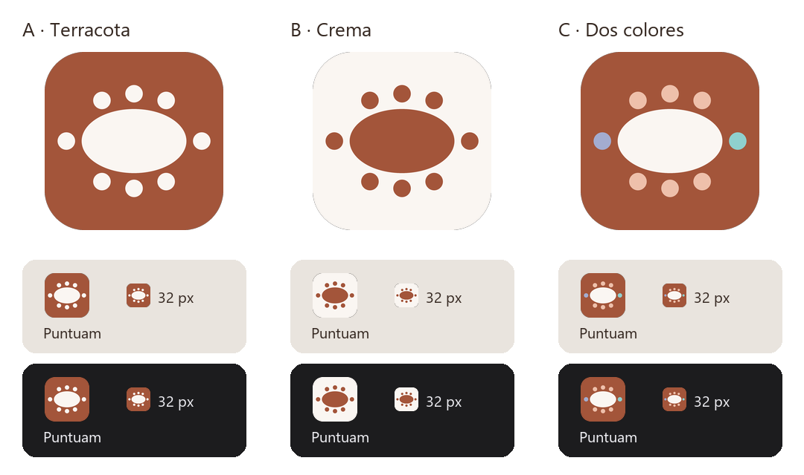
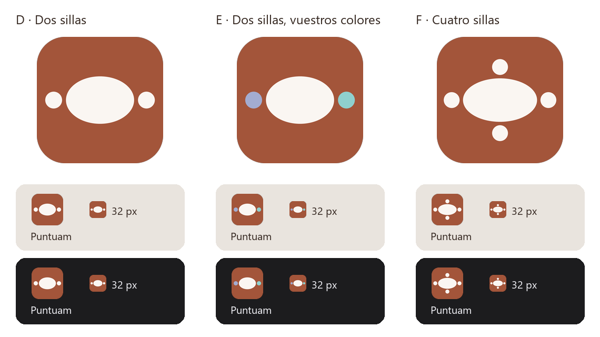
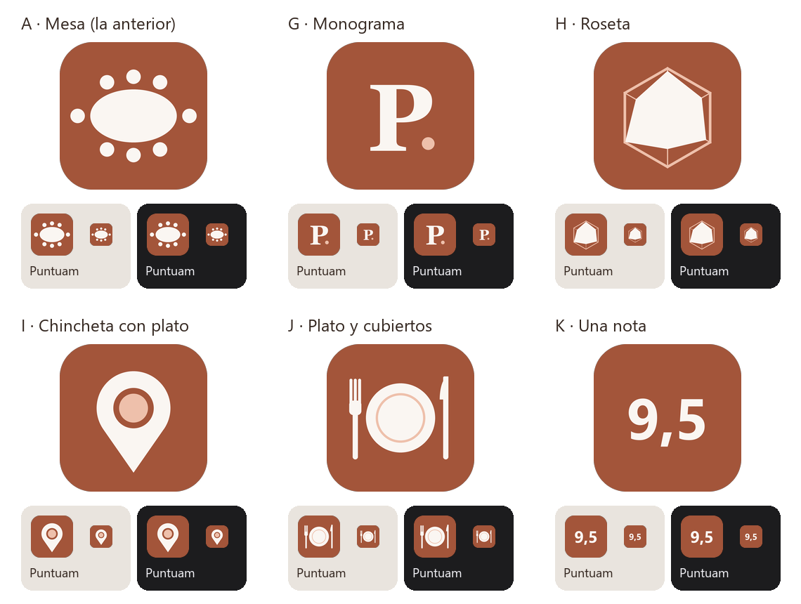

# Logotipo: opciones estudiadas

Propuestas para el icono de la app, preparadas el 25 de noviembre de 2026 (paso 5, parte «Icono e instalación»). El propietario eligió la **A** para usarla de momento y pidió guardar todas para estudiarlas más adelante.

Todas usan la paleta «Terracota suau» (`docs/diseno.md`, sección 7): terracota `#a3553a` (`--accent-strong`), crema `#faf6f2` (`--bg`), melocotón `#eec0ab` (`--accent`) y, en algunas, los colores de quien puntúa en su versión clara (tinta `#a3acd0`, turquesa `#8fd0ce`).

Cada lámina muestra el icono en grande, con las esquinas redondeadas del iPhone, y a tamaño de pantalla de inicio sobre fondo claro y oscuro. En las rondas 1 y 2 sale también a 32 px.

## Ronda 1: mesa ovalada con ocho sillas

Idea del propietario: una mesa ovalada vista en planta con las sillas como puntos alrededor, parecida al icono provisional (un plato crema sobre terracota).

- **A · Terracota.** Mesa y sillas en crema sobre terracota. **Elegida el 25 de noviembre de 2026.**
- **B · Crema.** Al revés: fondo crema, mesa y sillas en terracota. Más clara, destaca menos en la pantalla de inicio.
- **C · Dos colores.** Como la A, con las sillas en melocotón y las de las cabeceras en tinta y turquesa (Isidre y Cris).

Al propietario le pareció demasiado compleja, aunque después la A siguió siendo su preferida.

## Ronda 2: menos sillas

- **D · Dos sillas.** Una en cada cabecera.
- **E · Dos sillas, vuestros colores.** Como la D, en tinta y turquesa.
- **F · Cuatro sillas.** Una en cada lado.

Al propietario le parecieron peores que la ronda 1.

## Ronda 3: ideas distintas de la mesa

Con la A como referencia.

- **G · Monograma.** Una «P» con serifa, como los titulares de Inici, con un punto melocotón.
- **H · Roseta.** El gráfico hexagonal de la ficha. Lo más propio de la app.
- **I · Chincheta con plato.** Mapa y restaurante; parecida a muchas apps de mapas.
- **J · Plato y cubiertos.** El clásico, el más visto.
- **K · Una nota.** «9,5», como los recuadros de nota; un número fijo puede parecer una nota real.

Combinaciones apuntadas, sin dibujar: la roseta con las líneas en tinta y turquesa.

## Archivos

- `ronda-1.png`, `ronda-2.png`, `ronda-3.png`: las láminas.
- `opciones/`: cada opción a 512 px, sin redondear.
- `scripts/`: los scripts de Python (Pillow) que dibujaron cada ronda. Se ejecutan con `python scripts/ronda-1.py <carpeta de salida>`; las rondas 2 y 3 usan letras de Windows (Segoe UI y Georgia).
- Los iconos de la app se generan con `python tools/icons.py`, que dibuja la A en todos los tamaños (`icons/`).
